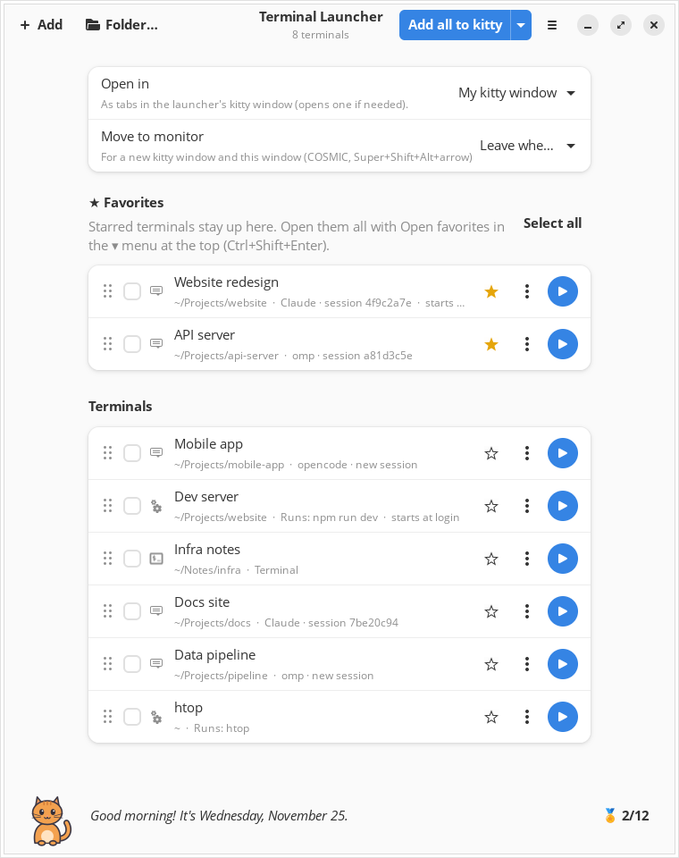
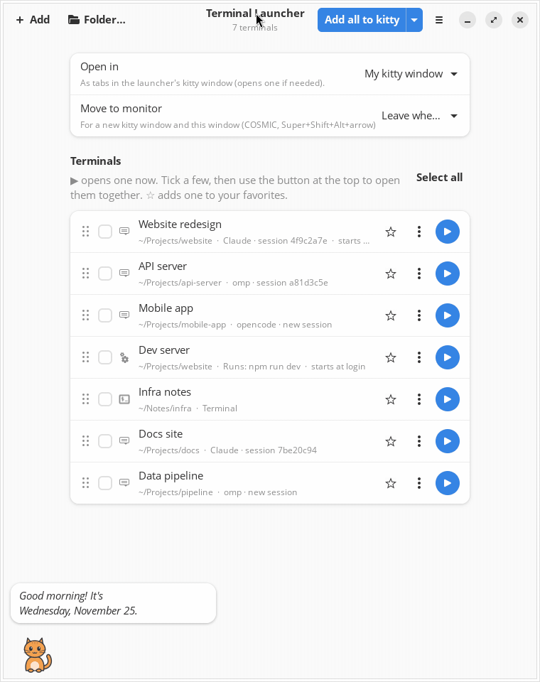
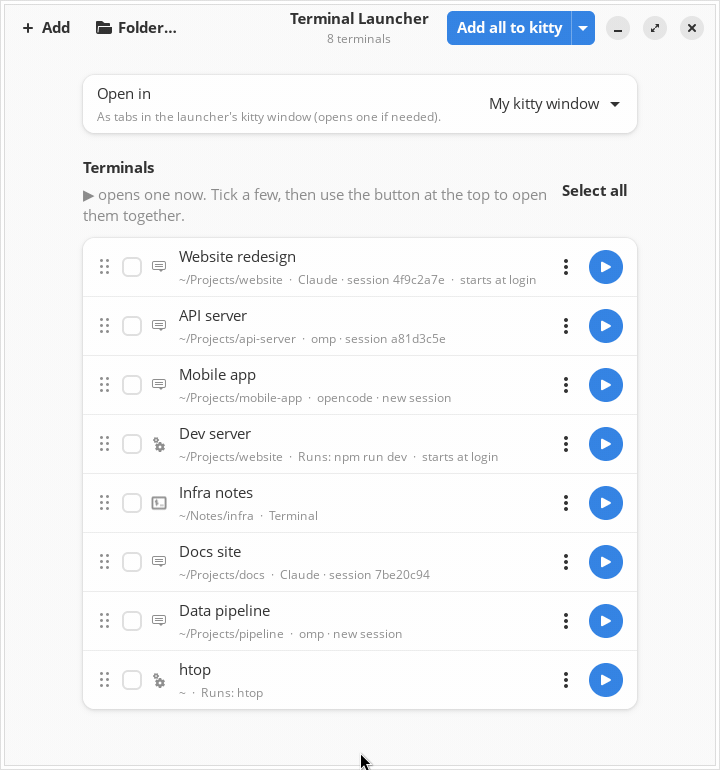
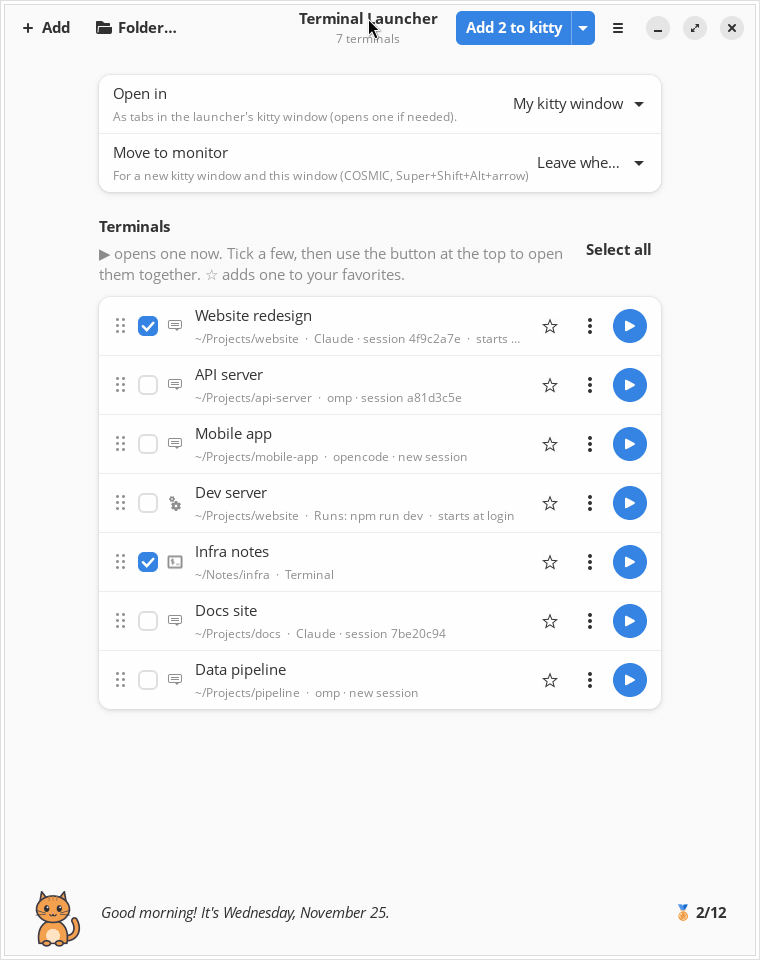
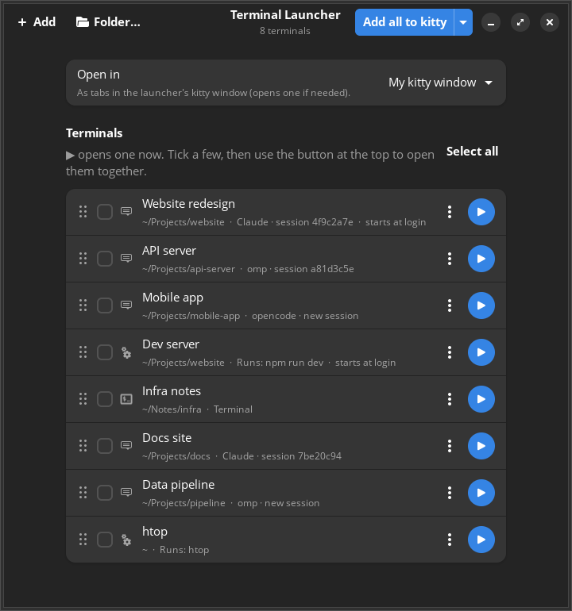
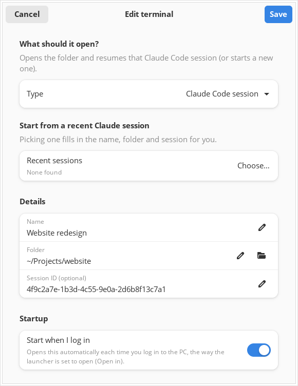

# Terminal Launcher

A small GTK 4 / libadwaita app for Linux (made on Pop!_OS COSMIC) that keeps a list of the terminals
you open every day and opens them with one click: coding-agent sessions (Claude Code, omp, opencode),
a plain shell in a project folder, or a command you run often. Mark any of them to **start when you
log in**.

<p align="center"></p>



**[Watch the 40-second tour on YouTube](https://youtube.com/shorts/m40501aopTc)**: adding an entry,
ticking a few, the three **Open in** modes and dragging rows, on a made-up list.

**More:** the [wiki](https://github.com/Vyeche/TerminalLauncher/wiki) has a page for each part
([Getting started](https://github.com/Vyeche/TerminalLauncher/wiki/Getting-Started),
[Troubleshooting](https://github.com/Vyeche/TerminalLauncher/wiki/Troubleshooting)).

## What it opens
| Type | What happens in the folder |
| --- | --- |
| Claude Code session | `claude --resume <ID>`, or `claude` for a new session |
| omp session | `omp --resume <ID>`, or `omp` |
| opencode session | `opencode --session <ID>`, or `opencode` |
| Terminal only | a shell |
| Run a command | your command, e.g. `npm run dev` or `htop` |

When the agent or command exits, the terminal stays open as a normal shell.
For Claude Code, **Start from a recent Claude session** fills in the name, folder and ID from Claude
Code's own history (`~/.claude/projects`).



## Where it opens them (**Open in**, remembered)
- **My kitty window**: as tabs in one kitty window that the launcher starts with remote control on a
  private socket (`unix:@claude-launcher-kitty`). Later launches add tabs to that same window. Your
  normal kitty settings aren't changed. Prefers the official kitty build in `~/.local/kitty.app`.
- **One new window**: one GNOME Terminal window with a tab for each.
- **Separate windows**: each in its own COSMIC Terminal window (falls back to GNOME Terminal, then
  `x-terminal-emulator`).

### Move to monitor (COSMIC, more than one screen)
On Wayland an app can't choose its monitor: COSMIC opens new windows on the monitor it considers
active, which may not be the one you're looking at (or the one you share over remote desktop). Set
**Move to monitor** to *Monitor below / above / to the left / to the right* and the launcher moves
the windows it opens there:

- a **new kitty window** (in **My kitty window** mode; tabs added to an open window stay where it is),
- the **launcher's own window** when it starts.

It presses COSMIC's own *Move window to monitor* shortcut (**Super+Shift+Alt+arrow**) on a
short-lived virtual keyboard (`/dev/uinput`, which the logged-in user may use; nothing to install).
It presses it only while the window it just opened has focus, so it never moves another window; if
that window doesn't get focus within 5 seconds, it's left where it is. On the far monitor already?
COSMIC then does nothing. Results go to the log. Off by default. It won't work if you've changed that
shortcut in COSMIC's settings, and GNOME Terminal / COSMIC Terminal windows (the other **Open in**
choices) aren't moved.

**▶** on a row opens that one now. Tick a few rows and use the button at the top to open them together
(nothing ticked = all). **Folder…** opens a shell anywhere without adding it to the list.
Drag a row by its handle (or anywhere on it) to change the order; **⋮** also has Move up / Move down.
Shortcuts: `Ctrl+N` add, `Ctrl+O` folder, `Ctrl+Enter` open, `Ctrl+Shift+Enter` open favorites.

### Favorites
**☆** on a row makes it a favorite: it moves up into **★ Favorites** at the top of the window
(**⋮** has *Add to favorites* too). Dragging a row into Favorites stars it, and dragging it back
down unstars it. **Open favorites** in the **▾** menu next to the top button (`Ctrl+Shift+Enter`)
opens all of them the way **Open in** says.

### Sounds, animations and tips
Small things that make it nicer to use and teach it as you go, all quiet and easy to turn off:
- **Sounds**: a soft two-note chime for a star (and a lower one when you take it away), a light
  pluck when something opens, a tock when a dragged row lands. They're made by the launcher itself
  (no sound files, nothing to install) and play with `pw-play`, `paplay` or `aplay`. Hear them all:
  `python3 terminal-launcher.py --sounds`.
- **Animations**: a new favorite's star pops and its row glows gold for a moment; ▶ gives a little
  press. They follow your desktop's animation setting.
- **Tips**: one short tip at the moment it's useful, each shown once: your first favorite, the first
  time you tick two rows, the first drag into Favorites, and, the third time you open the same
  terminal with ▶, a nudge to star it (with a **Star it** button).

**☰** at the top right turns **Sounds** and **Tips** on or off, and **Show tips again** brings the
tips back. Sounds also stay off when your desktop's own event sounds are off.

### Byte, the launcher's cat
A little ginger cat sits at the bottom of the window. You never have to feed it or look after it; it
just keeps you company:
- It **blinks, winks, swishes its tail, twitches an ear** and looks around, and **naps** late at night.
- It **says something** now and then: good morning with today's date, a **word of the day** (a
  computing word, explained plainly), a **joke of the day**, or a "did you know" shell tip. Click it
  for the next one (it says *mrrp?*).
- It **reacts** when you do things: a hop and a blush for a new favorite, a wave when something
  opens, a nod when a dragged row lands. The tips above come from the cat, too.
- **Badges:** twelve little quests to find, like your first star, opening 25 terminals, opening one
  before 7 in the morning or after 11 at night, trying all three **Open in** choices, and one secret.
  Earning one plays a small sparkle and the cat cheers. **🏅** next to the cat (or **☰ → Badges…**)
  shows what you've found and hints at the rest.

**☰ → Byte the cat** hides it (its timers stop too). It never goes online; the words, jokes and tips
are built in. No weather, for that reason.





<details><summary>The dark theme and the Edit dialog</summary>




</details>

## Start when I log in
In **Add** / **Edit**, turn on **Start when I log in** for each terminal or agent that should open by
itself. Rows that start at login say so in their subtitle.

- While at least one entry is marked, the launcher keeps one login entry at
  `~/.config/autostart/net.vyechi.TerminalLauncher.desktop`, which runs
  `terminal-launcher.py --autostart`. When nothing is marked, that file is removed.
- At login it waits 5 seconds for the desktop to settle, then opens only the marked entries, the
  way **Open in** is set (kitty tabs, one window with tabs, or separate windows).
- This runs when **you log in**, not at power-on: if the PC boots to the login screen, they open
  after you sign in.
- Results are logged to `~/.cache/terminal-launcher/launcher.log`.
- To see what would open without opening anything:
  ```bash
  python3 terminal-launcher.py --autostart --dry-run
  ```

## Install
Needs Python 3 with GTK 4 and libadwaita 1.4+ (`python3-gi`, `gir1.2-adw-1`, and `python3-gi-cairo`
for drawing the cat; already there on Pop!_OS 24.04 COSMIC and recent Ubuntu/Fedora GNOME).

```bash
git clone https://github.com/Vyeche/TerminalLauncher.git
cd TerminalLauncher
bash install.sh            # adds "Terminal Launcher" to the app menu
bash install.sh remove     # removes the menu and login entries (keeps your list)
```
The menu entry runs the script from where you cloned it, so keep the folder in place (run
`install.sh` again if you move it). No sudo needed; everything is per user.

## Command line
```bash
python3 terminal-launcher.py                # the window
python3 terminal-launcher.py --all          # every saved entry as tabs in one GNOME Terminal window
python3 terminal-launcher.py --all-windows  # every saved entry in its own window
python3 terminal-launcher.py --autostart    # the entries marked "Start when I log in"
python3 terminal-launcher.py --sounds       # plays each of the launcher's little sounds once
```
Add `--dry-run` to `--autostart` to print the commands instead of running them.

## Files
| Path | What |
| --- | --- |
| `terminal-launcher.py` | the app |
| `install.sh` | app-menu entry (`remove` to undo) |
| `assets/terminal-launcher.svg` | icon |
| `scripts/check.sh` | the checks (see [Contributing](CONTRIBUTING.md)) |
| `docs/images/`, `tools/` | the screenshots and GIFs, and the scripts that make them from a made-up list |
| `scripts/sync-public.sh`, `scripts/publish-wiki.sh` | for maintainers: publish to GitHub and its wiki |
| `docs/wiki/` | the [wiki](https://github.com/Vyeche/TerminalLauncher/wiki)'s pages |
| `~/.config/terminal-launcher/sessions.json` | your list (with each entry's star and how often you opened it) |
| `~/.config/terminal-launcher/settings.json` | the **Open in** and **Move to monitor** choices, Sounds, Tips, the cat, your badges and their counters |
| `~/.cache/terminal-launcher/sounds/` | the little sounds, made on first use |

## Coming from Claude Launcher
This is the renamed **Claude Launcher**. On first start it copies your list and settings from
`~/.config/claude-launcher/` (the old folder is left as it was), and `install.sh` replaces the old
"Claude Launcher" menu entry. The kitty socket keeps its old name, so a kitty window the old version
opened keeps getting the new tabs.

## Contributing
Bug reports, ideas and pull requests are welcome: see [CONTRIBUTING.md](CONTRIBUTING.md) and the
[Code of Conduct](CODE_OF_CONDUCT.md). Questions go to
[Discussions](https://github.com/Vyeche/TerminalLauncher/discussions); security problems privately,
as [SECURITY.md](SECURITY.md) explains.

## Authoring
Terminal Launcher was written with AI coding assistance, directed and reviewed by a human who decided
its design and scope. The app itself contains no AI and makes no network calls: it starts terminals
on your machine and keeps its list in your config folder.

It was built with [HOL Guard](https://hol.org/guard) in the loop: the AI coding sessions that worked
on it ran through a local harness where HOL Guard checked actions (destructive shell commands, secret
access, installs, data movement) before the assistant took them. It guards the development machine,
not the source; Terminal Launcher ships with none of it.

## Support
Terminal Launcher is free and MIT licensed. If it helps you,
**[:heart: Sponsor on GitHub](https://github.com/sponsors/Vyeche)**. That's genuinely optional: a
star, a real bug report or telling a colleague helps just as much.

## License
[MIT](LICENSE)
