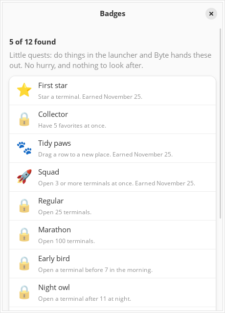

# Byte the cat and badges

Byte is a small ginger cat that lives in the launcher's window. You never have to feed it, play
with it or look after it: it's just there, and it does little things.

## Where it goes
Byte floats over the window and moves around on its own, every half a minute or so:
- **the floor**: along the bottom of the window (the list keeps a little room there for it);
- **beside the list**: up in the empty margins when the window is wide enough;
- **next to a row** you just starred, opened or dragged, for a few seconds;
- **peeking in** from the left or right edge, half outside the window;
- **outside**: it walks off one edge ("Going out for a stretch.") and comes back 20 to 60 seconds
  later from the other one ("Back! I saw a bird."). If it has something to tell you meanwhile, it
  comes straight back.

It walks along the floor and climbs straight up the margins and edges, so it never walks across your
list. Only the cat itself catches clicks: the space around it and its speech bubble let them
through. Rest the pointer on it for a second and it walks out of the way; while you drag a row it
lets the drop through. On a Wayland desktop an app can't put its own windows anywhere on the screen,
which is why Byte stays inside the launcher's window (and peeks over its edges).

## What it does
- **Moves on its own:** it blinks every few seconds, and now and then winks, swishes its tail, twitches
  an ear or looks around. From 11 at night to 6 in the morning it naps (*z z z*) between reactions.
- **Says something:** when the window opens it says good morning (or afternoon, or evening) with
  today's date. After that, every 45 seconds or so, the next of these:
  - a **word of the day**: a computing word explained plainly, like *daemon* or *pipe*;
  - a **joke of the day**: short and silly, and the same one all day;
  - a **"did you know"**: a shell or launcher tip you can try right away, like `cd -` or Ctrl+R;
  - the greeting again.
- **Click it** for the next line straight away. It winks and says *mrrp?*.
- **Reacts** to what you do: a hop and a blush when a terminal becomes a favorite, a wave when
  something opens, a nod when a dragged row lands, an ear twitch when you unstar one. The one-time
  tips come from the cat too (they start with *Psst*).

## Watching your kitty tabs
In **My kitty window** mode, Byte keeps an eye on the kitty window the launcher opened and says what
happened:

| What happens | Byte says (for example) |
| --- | --- |
| A build, test or install starts | *npm run build is running in API server. I'll keep an eye on it.* |
| It finishes after 20 seconds or more | *✓ npm run build finished in API server (2 min 05 s).* (and a soft "done") |
| A command fails | *✗ cargo test failed in API server (exit 101). You've got this.* (and a soft "oops") |
| You mistype a command | *gti isn't a command here. A typo?* |
| The command that failed works next time | *Fixed it! cargo test works now in API server.* |
| A `git push` works | *Pushed from API server. Off it goes!* |
| Claude, omp or opencode exits | *Claude in Website redesign is done. It might want you.* |

Quick everyday commands (`ls`, `cd`...) don't get a comment, and small things wait if Byte spoke a
moment ago.

How: every 2 seconds the launcher asks its own kitty window (the remote-control socket it opened it
with, read-only `kitty @ ls`) whether each tab's shell is at its prompt, the last command line and
how it ended, and which program is in front. kitty knows these through its shell integration, which
is on by default for bash, zsh and fish. Byte names a tab after the list entry whose folder it's in,
else after the folder. It shows only a command's name and subcommand (`npm test`, `git push`), never
the rest of the line, keeps nothing, and never sends anything anywhere. Other kitty windows, GNOME
Terminal and COSMIC Terminal aren't watched (they can't be asked). **☰ → Byte watches my kitty tabs**
turns it off; `--dry-run` never watches.

The words, jokes and tips are built into the launcher: it never goes online. That's also why it
doesn't show the weather.

## Badges
Twelve little quests. Earning one plays a small sparkle and Byte cheers. **☰ → Badges…** lists
them: the ones you've found with the date, and a hint for the rest. Byte's tooltip shows how many you
have.

| Badge | How |
| --- | --- |
| ⭐ First star | Star a terminal |
| 🌟 Collector | Have 5 favorites at once |
| 🐾 Tidy paws | Drag a row to a new place |
| 🚀 Squad | Open 3 or more terminals at once |
| ☕ Regular | Open 25 terminals |
| 🏃 Marathon | Open 100 terminals |
| 🐦 Early bird | Open a terminal before 7 in the morning |
| 🦉 Night owl | Open a terminal after 11 at night |
| 🧭 Explorer | Try all three **Open in** choices |
| 🗣️ Polyglot | Keep 3 different kinds of entries in your list |
| 🗺️ Wayfinder | Open a **Folder…** and keep it in the list |
| 🐱 ??? | A secret (the badges window gives a hint) |

Opening only counts for real opens, not with `--dry-run`. Badges and their counters are kept in
`settings.json` ([Files and settings](Files-and-Settings#settingsjson)).

## Turning it off
**☰ → Byte the cat** hides it, and its timers stop. Sounds have their own switch (**☰ → Sounds**),
and the cat follows your desktop's animation setting: with animations off it sits still and only
talks.

Drawing the cat needs GTK's cairo bridge (`python3-gi-cairo` on Debian, Ubuntu and Pop!_OS). Without
it the launcher works as usual and the cat stays hidden ([Installing](Installing)).
