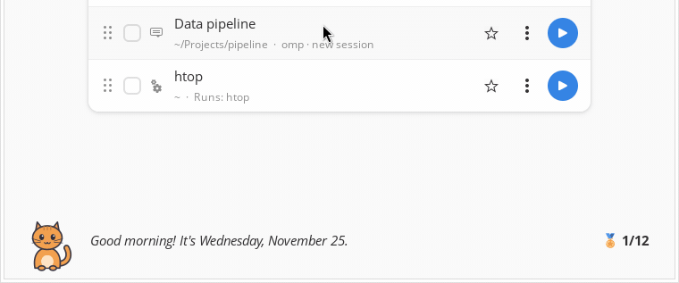

# Byte the cat and badges

Byte is a small ginger cat at the bottom of the launcher's window. You never have to feed it, play
with it or look after it: it's just there, and it does little things.

## What it does
- **Moves on its own:** it blinks every few seconds, and now and then winks, swishes its tail, twitches
  an ear or looks around. From 11 at night to 6 in the morning it naps (*z z z*) between reactions.
- **Says something:** when the window opens it says good morning (or afternoon, or evening) with
  today's date. After that, every 45 seconds or so, the next of these:
  - a **word of the day**: a computing word explained plainly, like *daemon* or *pipe*;
  - a **joke of the day**: short and silly, and the same one all day;
  - a **"did you know"**: a shell or launcher tip you can try right away, like `cd -` or Ctrl+R;
  - the greeting again.
- **Click it** for the next line straight away. It winks and says *mrrp?*.
- **Reacts** to what you do: a hop and a blush when a terminal becomes a favorite, a wave when
  something opens, a nod when a dragged row lands, an ear twitch when you unstar one. The one-time
  tips come from the cat too (they start with *Psst*).

The words, jokes and tips are built into the launcher: it never goes online. That's also why it
doesn't show the weather.

## Badges
Twelve little quests. Earning one plays a small sparkle and Byte cheers. **🏅 N/12** next to the
cat, or **☰ → Badges…**, lists them: the ones you've found with the date, and a hint for the rest.

| Badge | How |
| --- | --- |
| ⭐ First star | Star a terminal |
| 🌟 Collector | Have 5 favorites at once |
| 🐾 Tidy paws | Drag a row to a new place |
| 🚀 Squad | Open 3 or more terminals at once |
| ☕ Regular | Open 25 terminals |
| 🏃 Marathon | Open 100 terminals |
| 🐦 Early bird | Open a terminal before 7 in the morning |
| 🦉 Night owl | Open a terminal after 11 at night |
| 🧭 Explorer | Try all three **Open in** choices |
| 🗣️ Polyglot | Keep 3 different kinds of entries in your list |
| 🗺️ Wayfinder | Open a **Folder…** and keep it in the list |
| 🐱 ??? | A secret (the badges window gives a hint) |

Opening only counts for real opens, not with `--dry-run`. Badges and their counters are kept in
`settings.json` ([Files and settings](Files-and-Settings#settingsjson)).

## Turning it off
**☰ → Byte the cat** hides it, and its timers stop. Sounds have their own switch (**☰ → Sounds**),
and the cat follows your desktop's animation setting: with animations off it sits still and only
talks.

Drawing the cat needs GTK's cairo bridge (`python3-gi-cairo` on Debian, Ubuntu and Pop!_OS). Without
it the launcher works as usual and the cat stays hidden ([Installing](Installing)).
