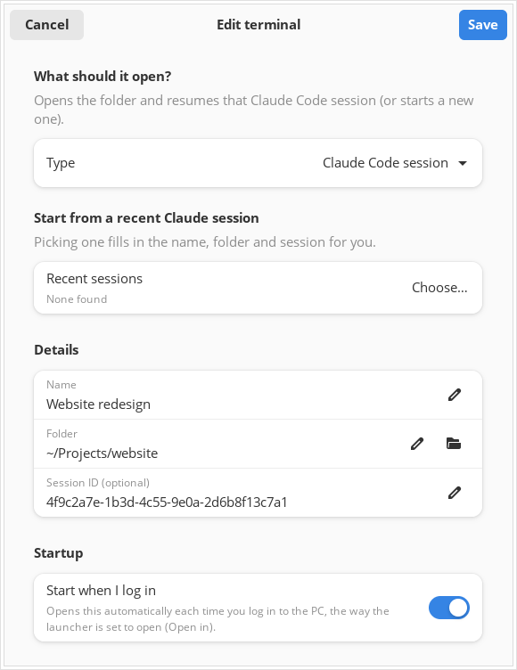

# Entry types

Each entry in the list has a **Type**, chosen at the top of **Add a terminal** / **Edit terminal**.
The type decides what runs in the entry's folder.



## The types
| Type | With a session ID | Without one |
| --- | --- | --- |
| **Claude Code session** | `claude --resume <ID>` | `claude` (a new session) |
| **omp session** | `omp --resume <ID>` | `omp` |
| **opencode session** | `opencode --session <ID>` | `opencode` |
| **Terminal only** | | a shell (`exec bash`) |
| **Run a command** | | your command, e.g. `npm run dev`, `git status` or `htop` |

The fields in the dialog follow the type: **Session ID (optional)** shows for the three agents,
**Command** only for *Run a command*, and **Start from a recent Claude session** only for
*Claude Code session*.

## Exactly what runs
Every entry runs in a login shell, `bash -lc '<command>'`, started in the entry's folder. When the
agent or command exits, a note is printed and the same terminal carries on as a normal interactive
shell, so you can look at the output or run something else.

For an agent, `<command>` is:
```bash
claude --resume 1a2b3c4d-0000-4000-8000-000000000000; echo; echo '[Claude exited. This is a normal shell now.]'; exec bash
```
(`omp` and `opencode` print `[omp exited. …]` and `[opencode exited. …]`.) The session ID is quoted
for the shell, so it's passed exactly as typed.

For *Run a command*:
```bash
npm run dev; echo; echo '[Command finished. This is a normal shell now.]'; exec bash
```
Your command is run as shell code, so pipes, `&&` and environment variables work
(`PORT=3001 npm run dev`).

For *Terminal only* it's just `exec bash`.

### Your shell setup
`bash -lc` reads your login files (`~/.profile` or `~/.bash_profile`), not all of `~/.bashrc`. On
Ubuntu-style systems `~/.profile` does read `~/.bashrc`, but `~/.bashrc` stops early for
non-interactive shells, so anything added near its end (a `PATH` change from a tool's installer,
aliases) isn't there when the agent or command starts. If you see `command not found`, move the
`PATH` line to `~/.profile`. The shell you get after the command exits is a normal interactive one
and has all of `~/.bashrc`.

The launcher also leaves out Claude Code's own internal environment variables (`CLAUDE_…`,
`CLAUDECODE`, `AI_AGENT` and a few more), in case you started it from inside a Claude session:
inherited, they would change how the new sessions behave. If you set a `CLAUDE_…` variable for
yourself, set it in `~/.profile` so the login shell puts it back.

## Session IDs
The ID is whatever you'd pass to resume the session by hand: `claude --resume <ID>`,
`omp --resume <ID>` or `opencode --session <ID>`. Leave it empty to start a new session each time
you open the entry.

Resuming a session that is already open somewhere else opens a second copy of it. The row's second
line shows the first 8 characters of the ID, or *new session*.

## Start from a recent Claude session
For *Claude Code session*, the **Recent sessions** list offers up to 30 of your newest Claude Code
sessions, newest first, each as *title · folder · date*. Picking one fills in **Name**, **Folder** and
**Session ID**; you can still change them before saving.

It reads Claude Code's own history in `~/.claude/projects` (only reading, never changing it). The
title is the session's name in Claude Code, or else the start of its first message. If the list says
*None found*, there is no Claude Code history in `~/.claude/projects` yet.

The picker is only for Claude Code. For omp and opencode, copy the ID from the agent itself.

## Name and folder
- **Name** is what the list shows. Left empty, the folder's name is used.
- **Folder** is where the terminal starts. `~` means your home folder. A folder that doesn't exist is
  allowed (you can save it and create the folder later); until it exists the row is red and its **▶**
  is grayed out.
