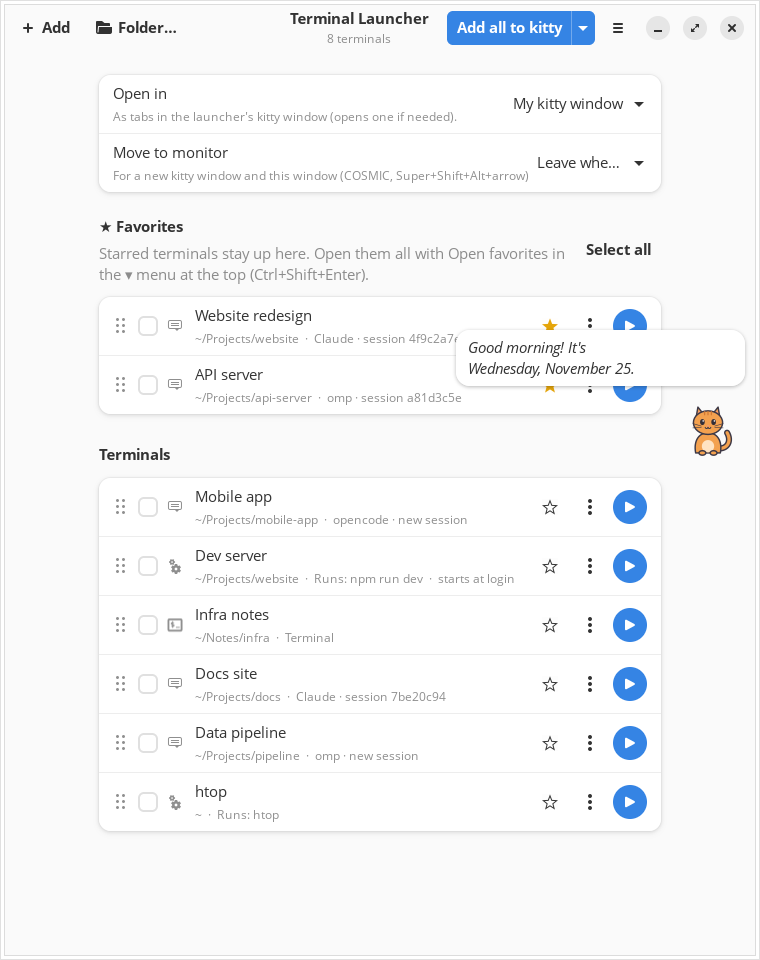
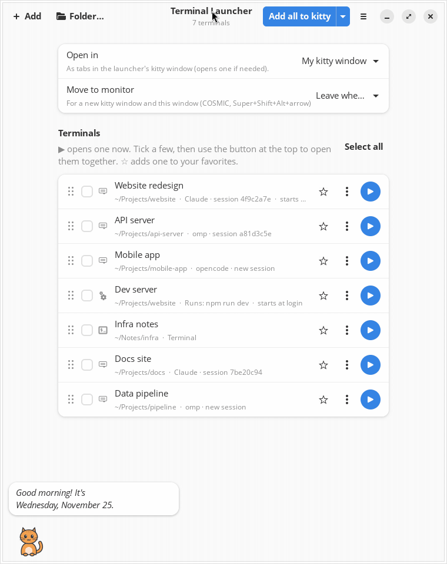
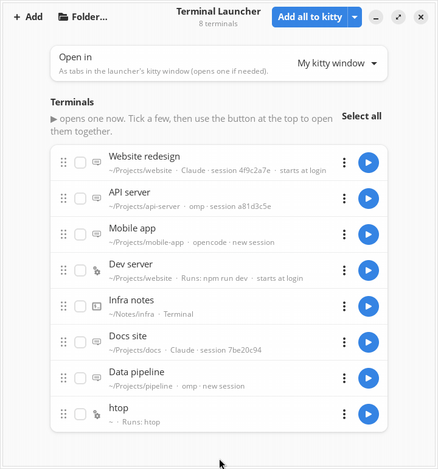
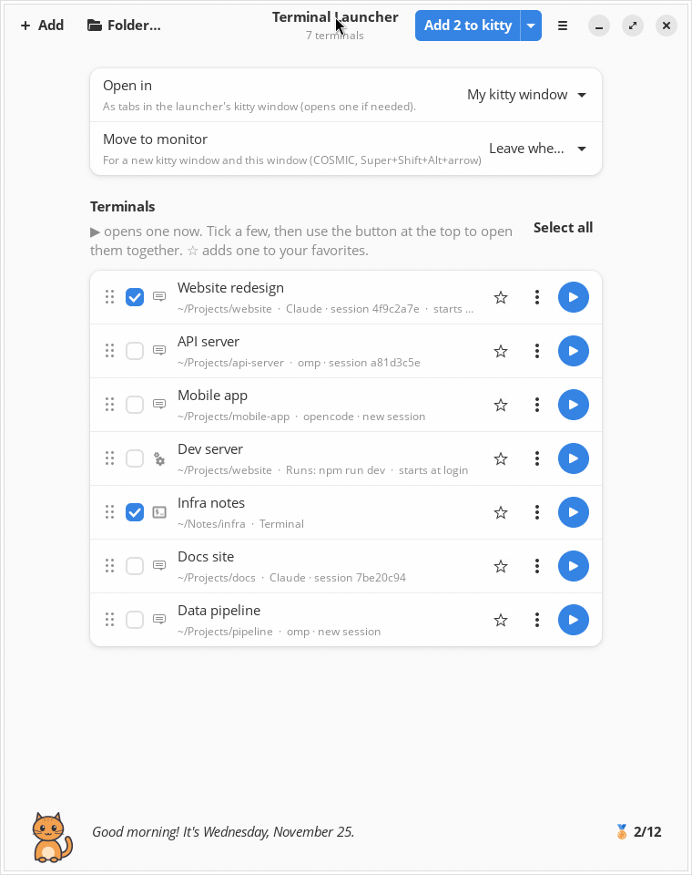
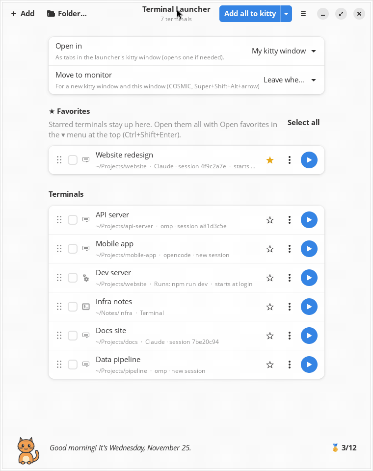

# Getting started

From an empty list to your day's terminals opening with one click.



## 1. Install
You need Python 3 with GTK 4 and libadwaita 1.4+, and a terminal (kitty, GNOME Terminal or COSMIC
Terminal).
```bash
git clone https://github.com/Vyeche/TerminalLauncher.git && cd TerminalLauncher
bash install.sh            # adds "Terminal Launcher" to the app menu
```
Packages for each distro, and how to remove it again: [Installing](Installing).

## 2. Add your first terminal
Open **Terminal Launcher** from the app menu. The list starts empty: click **Add a terminal** (or
**Add** at the top left, or press **Ctrl+N**).



In **Add a terminal**:
1. **Type**: what it should open. *Claude Code session*, *omp session*, *opencode session*,
   *Terminal only* (a shell) or *Run a command*. See [Entry types](Entry-Types).
2. **Folder**: where the terminal starts. Type a path (`~` means your home folder) or click the
   folder button to choose one.
3. **Name** (optional): shown in the list. Left empty, the folder's name is used.
4. **Session ID** (agents only, optional): the session to resume. Leave it empty to start a new
   session each time. For Claude Code, **Start from a recent Claude session** fills in the name,
   folder and ID for you.
5. **Command** (*Run a command* only): for example `npm run dev` or `htop`.

**Save** turns on once there is a folder (and a command, for *Run a command*). A folder that doesn't
exist yet is shown in red; you can still save it.

## 3. Open it
Click **▶** on the row. It opens right away, and a short message at the bottom says
*Opened api* (or what went wrong). When the agent or command exits, the terminal stays open as a
normal shell.

Clicking the row itself doesn't open anything: it ticks it (step 5). **▶** is the only way to open
one row.

## 4. Choose where things open
The **Open in** row at the top of the window decides where terminals open, and it's remembered:

| Open in | What happens |
| --- | --- |
| **My kitty window** | as tabs in one kitty window the launcher keeps (it opens one if needed) |
| **One new window** | one new GNOME Terminal window, with a tab for each |
| **Separate windows** | each in its own COSMIC Terminal window |

The same choice is in the small **▾** next to the button at the top. **One new window** is where a
new install starts. The details, and what happens when a terminal is missing:
[Open in](Open-In-Modes).

## 5. Open several at once
Click rows (or their tick boxes) to tick them. The button at the top follows along:
*Open 3 in tabs*, *Add 3 to kitty* or *Open 3 in windows*, depending on **Open in**. With nothing
ticked it opens everything: *Open all in tabs*, *Add all to kitty*, *Open all in windows*.
**Ctrl+Enter** does the same as the button.

**Select all** ticks every row; when they're all ticked it says **Clear**.



## 6. Put them in order
Drag a row by its handle (the dotted grip at its left edge) and drop it on another row: it takes that row's
place. A line in your accent color shows where it will land, and while you drag near the top or
bottom edge the list scrolls. The new order is saved at once, and your ticks stay as they were.



You can grab a row anywhere, not only by the handle. The handle shows once the list has two or more
rows. **⋮ → Move up / Move down** also moves a row one step.

## 7. Star your favorites
**☆** on a row makes it a favorite: it moves up into **★ Favorites** at the top of the window, its
star turns gold with a little pop, and the row glows for a moment. **☆** again (or **⋮ → Remove from
favorites**) puts it back at the top of **Terminals**.



You can also drag a row into Favorites to star it, or drag a favorite down among the rest to
unstar it. **Open favorites** in the **▾** menu next to the top button (**Ctrl+Shift+Enter**) opens
all of them, the way **Open in** says.

The third time you open a terminal with **▶** that isn't a favorite yet, a tip suggests starring
it, with a **Star it** button (once: like every tip, it shows only one time).

## 8. Start some at login
Open **⋮ → Edit…** on a row and turn on **Start when I log in**. The row's second line then says
*starts at login*. Next time you log in, the marked rows open by themselves, the way **Open in** is
set. More: [Start at login](Start-At-Login).

## More to try
**A one-off shell:** **Folder…** (or **Ctrl+O**) opens a terminal in any folder right away without
adding it to the list. The message that follows has a **Keep in list** button if you change your
mind.

**The ⋮ menu** on each row:
- **Edit…** changes the entry.
- **Add to favorites** / **Remove from favorites** stars it or not, like **☆**.
- **Move up** / **Move down** move it one step, inside Favorites or inside Terminals.
- **Remove from list…** asks first, then takes it off the list. Nothing else is deleted: an agent's
  session and its history stay where they are.

**A red row** means its folder is gone; its **▶** is grayed out. Fix the folder with **Edit…**.

**Shortcuts**

| Key | Does |
| --- | --- |
| Ctrl+N | Add a terminal |
| Ctrl+O | Folder…: open a terminal in any folder |
| Ctrl+Enter | the button at the top: open the ticked rows, or all |
| Ctrl+Shift+Enter | Open favorites |
| Esc | close the Add / Edit dialog without saving |

Ticks stay when you add, drag, star, edit or use **Move up** / **Move down**; removing a row (or
**Keep in list** after **Folder…**) clears them.

**Sounds and tips:** the launcher plays a few soft sounds (a chime for a star, a pluck when something
opens, a tock when a dragged row lands) and shows one short tip the first time something is useful,
each tip only once. **☰** at the top right turns **Sounds** and **Tips** off, and **Show tips again**
brings the tips back. To hear the sounds: `python3 terminal-launcher.py --sounds`.
