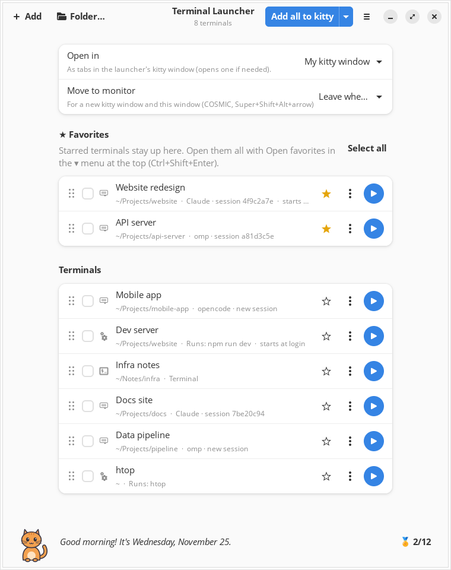

# Terminal Launcher

A small GTK 4 / libadwaita app for Linux (made on Pop!_OS COSMIC, Wayland) that keeps a list of the
terminals you open every day and opens them with one click: coding-agent sessions (Claude Code,
omp, opencode), a plain shell in a project folder, or a command you run often. Mark any of them to
**start when you log in**.

**[Watch the 40-second tour on YouTube](https://youtube.com/shorts/m40501aopTc).**



```
 + Add   Folder…     Terminal Launcher      Open all in tabs ▾  ☰   the button at the top; sounds and tips
                       3 terminals
 Open in                          One new window ▾                  where things open (remembered)
 Move to monitor                  Leave where… ▾                    COSMIC: move new windows to a monitor

 ★ Favorites                                  Select all
 ⠿ ☐  api                                     ★  ⋮  ▶           drag handle, tick, name, star, menu, open
      ~/code/api  ·  Claude · session 1a2b3c4d                    folder · type · session

 Terminals
 ⠿ ☐  dev server                              ☆  ⋮  ▶
      ~/code/web  ·  Runs: npm run dev  ·  starts at login        opens by itself when you log in
 ⠿ ☐  old notes                               ☆  ⋮  ▶           (red: the folder is gone)
      Folder not found: ~/notes-2023
```

## Start here
- [Getting started](Getting-Started): your first entry, ▶, ticking rows, **Open in** and favorites
- [What's new](Whats-New): recent changes
- [Installing](Installing): what you need on each distro, `install.sh`, removing, moving the folder
- [Entry types](Entry-Types): Claude Code, omp, opencode, a plain terminal or a command, and the exact command each one runs
- [Open in](Open-In-Modes): your kitty window, one GNOME Terminal window, or separate COSMIC windows, and **Move to monitor**
- [Start at login](Start-At-Login): what opens when you log in, and how to check it
- [Command line](Command-Line): `--all`, `--all-windows`, `--autostart`, `--dry-run`, `--sounds`
- [Files and settings](Files-and-Settings): `sessions.json`, `settings.json`, coming from Claude Launcher
- [Troubleshooting](Troubleshooting)

## How it's meant to be
1. **One click to get back to work.** Your agents and shells open in the right folders, resumed
   where you left them.
2. **Yours only.** Everything is per user: no sudo, nothing outside `~/.config`, `~/.cache` and
   `~/.local/share/applications`.
3. **Nothing surprising.** Start at login is off for every entry until you turn it on. Your kitty
   settings are never changed. Removing an entry only takes it off the list.
4. **Small.** One Python file, using only Python's standard library and PyGObject (GTK 4,
   libadwaita). No network calls, and no AI inside the app: it starts terminals on your machine.

Code, issues and releases: [github.com/Vyeche/TerminalLauncher](https://github.com/Vyeche/TerminalLauncher).
These pages live in the repository under `docs/wiki/`; edit them there and publish with
`bash scripts/publish-wiki.sh`.
