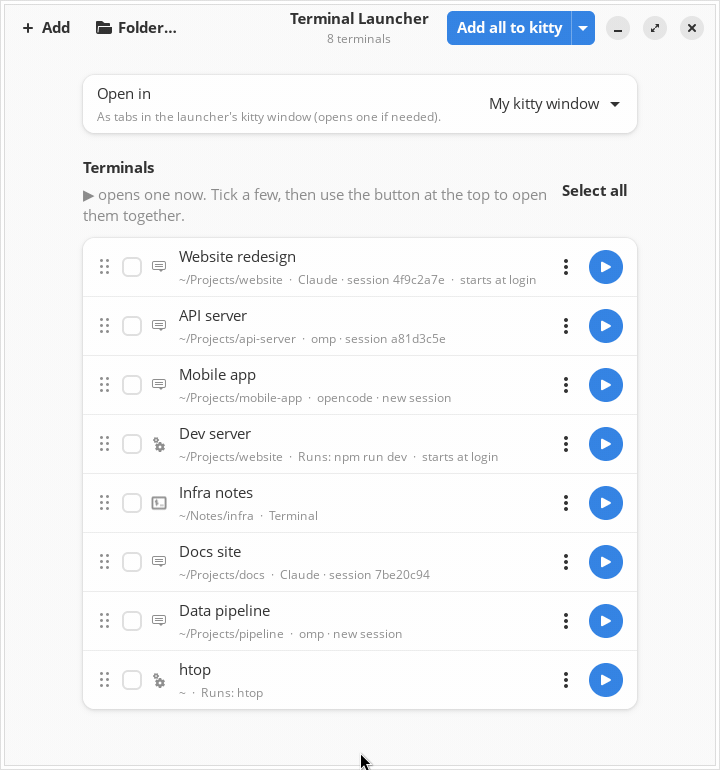

# Open in

**Open in**, at the top of the window (and in the **▾** next to the button at the top), decides
where terminals open. It's remembered in `settings.json`. A new install starts with
**One new window**.



| Open in | The button at the top | ▶ and Folder… |
| --- | --- | --- |
| **My kitty window** | *Add 3 to kitty*: tabs in the launcher's kitty window | a new tab in that window |
| **One new window** | *Open 3 in tabs*: one new GNOME Terminal window, a tab each | a window of its own |
| **Separate windows** | *Open 3 in windows*: a COSMIC Terminal window each | a window of its own |

With nothing ticked the button opens every row (*Add all to kitty*, *Open all in tabs*,
*Open all in windows*). **Open in** is also what [Start at login](Start-At-Login) uses.
The `--all` and `--all-windows` switches don't follow it; see [Command line](Command-Line).

If some rows' folders are missing, those are skipped, the rest still open, and the message at the
bottom names the first one that couldn't. (A kitty problem is different: see below.)

## My kitty window
The launcher starts **its own kitty window** and keeps adding tabs to it. The first time (or after
you closed that window) it runs:
```bash
kitty -o allow_remote_control=socket-only --listen-on unix:@claude-launcher-kitty --directory <folder> bash -lc '<command>'
```
and every later entry becomes a new tab in that window:
```bash
kitty @ --to unix:@claude-launcher-kitty launch --type=tab --cwd <folder> bash -lc '<command>'
```
- Remote control is turned on only for that one window and only on that private socket. Your
  `kitty.conf` and your other kitty windows aren't touched, and kitty windows you opened yourself
  never get the launcher's tabs.
- The socket is called `claude-launcher-kitty` because the app used to be called Claude Launcher.
  The name stays, so a kitty window the old version opened keeps getting the new tabs, and scripts
  that look for the window by that name keep working.
- Tabs get no fixed title, so each agent's own live title shows on its tab.
- After starting a new kitty window the launcher waits up to about 8 seconds for it to answer. If it
  doesn't, you get *kitty started but isn't answering; try again*.
- Which kitty: the official build in `~/.local/kitty.app` if you have it (it's newer than most
  distro packages), otherwise `kitty` on your `PATH`. Without either you get
  *kitty isn't installed yet*. There is no fallback to another terminal in this mode: install kitty
  or pick another **Open in**.

## One new window
The button at the top opens **one new GNOME Terminal window** with a tab for each entry:
```bash
gnome-terminal --window --working-directory=<folder 1> -e "bash -lc '<command 1>'" \
               --tab    --working-directory=<folder 2> -e "bash -lc '<command 2>'"
```
- Without `gnome-terminal`, they open as separate windows instead (as below).
- **▶** and **Folder…** open just one terminal, so they open it in a window of its own, the same way
  **Separate windows** does: in COSMIC Terminal if you have it. (COSMIC Terminal can't be told from
  outside to open tabs, which is why tabs use GNOME Terminal.)

## Separate windows
Each entry gets **its own window**, in the first terminal of these that is installed:

| Terminal | Command |
| --- | --- |
| COSMIC Terminal | `cosmic-term -w <folder> -- bash -lc '<command>'` |
| GNOME Terminal | `gnome-terminal --working-directory=<folder> -- bash -lc '<command>'` |
| your system's default | `x-terminal-emulator -e bash -lc 'cd <folder> && <command>'` |

`<command>` is what the entry runs: see [Entry types](Entry-Types#exactly-what-runs).
