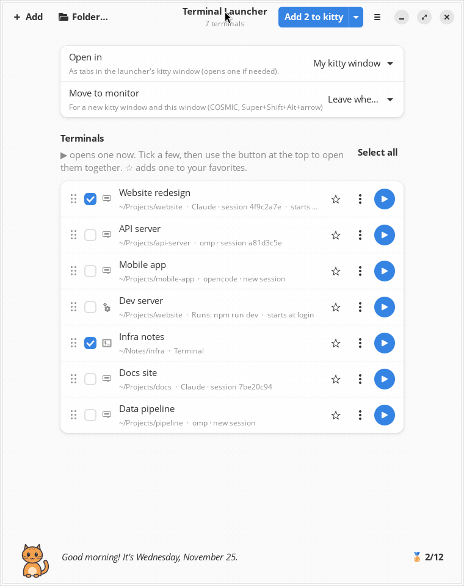

# What's new

Changes you'd notice, newest first. To get them: `git pull` in your clone, then close and reopen the
launcher (see [Installing](Installing#updating)).

## 2026-11-25 (evening)
- **Byte walks around:** it no longer sits in a bar at the bottom. It walks along the floor of the
  window, climbs up beside the list, visits the row you just starred or opened, peeks in from the
  edges and now and then goes outside for a while. Its words show in a speech bubble that fades. It
  never walks across your list, and it gets out of the way of the pointer and of drags.
  See [Byte the cat and badges](Byte-the-Cat#where-it-goes).

## 2026-11-25 (later)
- **Byte the cat:** a little ginger cat at the bottom of the window blinks, winks, naps at night,
  reacts to what you do, and says something now and then: the date, a word of the day, a joke, a
  shell tip. Click it for the next one. See [Byte the cat and badges](Byte-the-Cat).
- **Byte watches your kitty tabs:** in **My kitty window** mode it comments when a long build or
  test finishes, a command fails or gets fixed, you mistype one, a `git push` works, or an agent is
  done. Command names only, never their arguments. **☰** turns it off.
- **Badges:** twelve little quests (your first star, 25 opens, an early-bird open, trying every
  **Open in** choice, a secret...). **🏅** next to the cat shows them.
- A new [48-second tour on YouTube](https://youtube.com/shorts/3tdUWFhMW3Y), with sound.
- Needs `python3-gi-cairo` to draw the cat ([Installing](Installing)); without it the cat stays hidden.

## 2026-11-25
- **Favorites:** **☆** on a row stars it, and it moves up into **★ Favorites** at the top. Drag a
  row into Favorites to star it, or out to unstar it. **Open favorites** in the **▾** menu
  (Ctrl+Shift+Enter) opens them all. See [Getting started](Getting-Started#7-star-your-favorites).
- **Sounds, animations and tips:** soft sounds for a star, an open and a drop; a star that pops and a
  row that glows; and short one-time tips at the moment they're useful, like a nudge to star a
  terminal you open a lot. **☰** turns sounds and tips off. Hear the sounds with `--sounds`.
- **Move to monitor (COSMIC):** with more than one screen, the launcher can move a new kitty window
  and its own window to the monitor below, above, left or right. See
  [Open in](Open-In-Modes#move-to-monitor-cosmic-more-than-one-screen).
- **Ticks stay** when you edit a row or use **Move up / Move down** (dragging already kept them).

## 2026-11-24
- **First public release.** Terminal Launcher is on GitHub: a small GTK 4 / libadwaita window that
  keeps a list of your terminals and coding-agent sessions (Claude Code, omp, opencode), a plain
  shell in a folder, or a command you run often, and opens them with one click. Open them as tabs in
  one kitty window, as tabs in one GNOME Terminal window, or in separate COSMIC Terminal windows
  ([Open in](Open-In-Modes)). Mark any of them to open by themselves when you log in
  ([Start at login](Start-At-Login)). It's the renamed Claude Launcher, and moves your list over by
  itself ([Files and settings](Files-and-Settings#coming-from-claude-launcher)).
  A [40-second tour on YouTube](https://youtube.com/shorts/m40501aopTc) shows it in action.
- **Drag to reorder:** with two or more rows, each row has a drag handle. Drag a row onto another
  one and it takes that row's place. A line in your accent color shows where it will land, the list scrolls while you drag
  near its top or bottom edge, and your ticks and scroll position stay as they were. The new order is
  saved at once. **⋮ → Move up / Move down** are still there.

  
